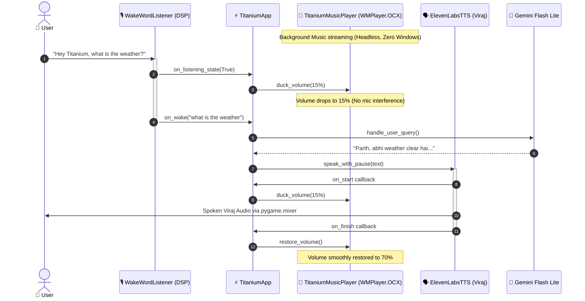

# 🌌 Titanium — Autonomous Agentic Virtual Assistant

**Titanium** is an ultra-lightweight, hardware-accelerated desktop assistant featuring an animated 3D Siri-like floating orb, Google Gemini AI intelligence, real-time screen vision, ElevenLabs speech synthesis in natural **Hinglish** (Viraj voice), always-on microphone with **"Hey Titanium"** wake word detection, continuous conversational sessions, in-process headless music streaming with audio ducking, and instant **Circle to Search**.

---

## ✨ Key Features

- **Top-Right 3D Siri Orb UI (`PySide6`)**:
  - Transparent, frameless circular widget docked at the top-right of your desktop with smooth AmazingUI 3D energy sphere visuals (60 FPS).
  - 4 distinct animated states with organic plasma & specular glass:
    1. **Listening**: Dynamic acoustic shockwaves & electric cyan-azure pulses.
    2. **Thinking**: Swirling dual-vortex cosmic nebula.
    3. **Speaking**: Voice-amplitude reactive coral & amber bounce.
    4. **Seeing (Vision)**: Cyber emerald scanner eye with targeting reticle during Screen Share and Circle to Search.
  - Fully draggable anywhere on your multi-monitor setup.
  - Left-click to instantly toggle live listening.
- **Always-On Device Microphone & Anti-Typing DSP ("Hey Titanium")**:
  - Continuously listens in a low-power background thread (<1% CPU, ~0% idle).
  - 4th-order Butterworth acoustic bandpass filter (300 Hz – 3400 Hz) and crest-factor analysis rejecting mechanical keyboard clicks up to 90+ WPM.
  - Rising audio chime confirms wake-word detection (<10ms).
- **One-Time Startup Greeting & Clean Conversation Turns**:
  - Spoken greeting (*"Haanji Parth, bataiye kya baat hai? Main hoon aapki help karne ke liye"*) executes **only once** at application launch.
  - User speech is instantly mirrored docked below the Orb in a Gemini dark-mode bubble (`#131314`) shifted right, followed by Gemini's crisp response.
- **In-Process Headless Music Player & Automatic Audio Ducking**:
  - Stream music directly in background using Windows Media Player COM (`WMPlayer.OCX`) and `yt-dlp` **without opening any browser tabs, Spotify apps, or GUI windows**.
  - **Voice Control**: *"Play Shape of You"*, *"Play lofi chill beats"*, *"Gaana bajao"*, *"Pause music"*, *"Resume music"*, *"Stop music"*, *"Music volume 60"*.
  - **Automatic Audio Ducking**: Background music automatically drops to 15% volume whenever you speak or Titanium responds, and smoothly restores when speech finishes.
- **Strictly Single Process & Single Orb (Socket IPC Lock)**:
  - Localhost socket IPC on port `48123` ensures that only **one Titanium process** and **one Orb** ever exists on your desktop.
  - Launching Titanium from the Start Menu when already running brings the existing Orb to the top-right and exits in 0.05 seconds.
- **Continuous Live Sessions (Google Gemini Live Style)**:
  - Say *"Hey Titanium, start live conversation"* to enter continuous back-to-back conversation without repeating the wake word.
  - Say *"Hey Titanium, follow the conversation"* for multi-turn conversational follow-up.
- **ElevenLabs Speech Synthesis**:
  - Configured to **Viraj** (*Rich, Confident and Expressive — Hindi Standard*) via `eleven_multilingual_v2`.
  - In-process hardware-accelerated audio streaming via `pygame.mixer`.
- **Universal Cross-Platform System Navigator (Windows, macOS, Linux)**:
  - **Native Settings Launcher**: Opens Windows Settings (`ms-settings:`), macOS System Settings, or Linux control center.
  - **Explorer & Folder Navigation**: Directly opens Downloads, Documents, Desktop, Pictures, and Projects in native file managers.
  - **Smart File Opener**: Finds and opens requested files using the system default handler.
  - **Zero-Latency App Launching**: Sub-10ms launching of desktop apps (*Calculator, Spotify, Chrome, VS Code, Notepad, etc.*).
- **Circle to Search (`Ctrl + Shift + S`)**:
  - Translucent sniper overlay allowing rectangular or lasso selection of any screen region.
  - Immediately analyzes images, charts, code errors, or text with Gemini Vision.
- **Real-Time Screen Share (Gemini 3.8 Live)**:
  - Streams your screen at 1 FPS into Gemini Live for real-time visual assistance.
- **Ultra-Low Memory Footprint**:
  - **~58 MB active RAM** with zero electron bloat.
  - Persistent SQLite memory (`titanium_memory.db`) for preferences and conversation context.
- **Windows System Integration**:
  - Windows Start Menu shortcut (search "Titanium" to launch).
  - Task Manager Startup integration (starts automatically with your PC).

---

## 🏗️ System Architecture & Visual Blueprint (Archify)

Titanium is architected with clear layer separation, event-driven Qt signals, and lock-free thread coordination.

> 🌐 **Interactive Archify Blueprint**: Open [`archify-out/architecture.html`](archify-out/architecture.html) in your browser for the full interactive canvas with pan/zoom, module inspectors, and sequence diagrams.

### System Architecture Diagram
```mermaid
flowchart TB
    subgraph UI_Layer["🖥️ Presentation Layer (PySide6)"]
        Orb["SiriOrbWidget<br/><i>60 FPS Canvas | AmazingUI 3D Sphere</i>"]
        Pill["CompactSubtitlePill<br/><i>Gemini Dark Bubble (Right)</i>"]
        Overlay["CircleToSearchOverlay<br/><i>Sniper / Lasso Area</i>"]
        Tray["TitaniumTrayIcon<br/><i>System Tray Resident</i>"]
    end

    subgraph Perception_Layer["🎙️ Input & Perception Layer"]
        Mic["WakeWordListener<br/><i>DSP Bandpass 300-3400Hz | Anti-Typing</i>"]
        Screen["ScreenVision<br/><i>MSS 1 FPS Desktop Grabber</i>"]
        Hotkey["GlobalHotkey<br/><i>Ctrl + Shift + S Hook</i>"]
    end

    subgraph Core_Layer["⚡ Core Orchestration (main.py)"]
        Controller["TitaniumApp<br/><i>State Machine & Signal Hub</i>"]
        Router["AgentRouter<br/><i>Fast Intent Dispatch</i>"]
        Memory["MemoryManager<br/><i>SQLite Persistent Store</i>"]
        IPCLock["SingleInstanceLock<br/><i>TCP Port 48123 IPC</i>"]
    end

    subgraph Media_Layer["🎵 Audio & Intelligence Layer"]
        Music["TitaniumMusicPlayer<br/><i>Headless WMPlayer.OCX + yt-dlp</i>"]
        TTS["ElevenLabsTTS<br/><i>Viraj Voice | pygame.mixer</i>"]
        GeminiLive["GeminiLiveClient<br/><i>WebSocket Bidi-Streaming</i>"]
        GeminiFlash["Gemini 2.5 Flash Lite<br/><i>Sub-second conversational LLM</i>"]
    end

    subgraph System_Layer["💻 OS Execution Tools"]
        Navigator["SystemNavigator<br/><i>Folders / Files / Settings</i>"]
        Launcher["WindowsAppLauncher<br/><i>Zero-Latency Fast Launch</i>"]
        Installer["WindowsInstaller<br/><i>Start Menu & Task Manager Autostart</i>"]
    end

    %% Wiring
    Mic -->|Wake 'Hey Titanium'| Controller
    Hotkey -->|Trigger| Overlay
    Orb -->|Click / Live Toggle| Controller
    Controller -->|Dispatch Query| Router
    Router -->|Play / Pause / Duck| Music
    Router -->|Speak Answer| TTS
    Router -->|Conversational Turn| GeminiFlash
    Overlay -->|Analyze Crop| Router
    Controller -->|Live Frames| GeminiLive
    Router -->|Launch Apps| Launcher
    Router -->|Navigate FS| Navigator
    Controller -->|Update State| Orb
    Controller -->|Render Prompt & AI| Pill
    TTS -.->|Audio Ducking (15%)| Music
    Mic -.->|Speaking Ducking (15%)| Music
```

### Audio Ducking & Music Playback Sequence


---

## 🌐 Knowledge Graph & Codebase Intelligence (Graphify)

Titanium is indexed using **Graphify** (`graphifyy`), generating a deterministic AST knowledge graph with community detection, god nodes, and GraphRAG-ready structure.

- **Total Graph Size**: 362 nodes · 626 edges · 18 communities
- **Audit Trail**: 92% EXTRACTED · 8% INFERRED · 0% AMBIGUOUS

### Viewing the Interactive Knowledge Graph & Call Flow
- **Interactive Knowledge Graph**: Open [`graphify-out/graph.html`](graphify-out/graph.html) in your browser.
- **Mermaid Call-Flow Architecture**: Open [`graphify-out/Titanium-callflow.html`](graphify-out/Titanium-callflow.html) in your browser.
- **Detailed Graph Report**: View [`graphify-out/GRAPH_REPORT.md`](graphify-out/GRAPH_REPORT.md).

### Querying the Codebase with Graphify
You can traverse and query the Titanium codebase directly from the terminal:

```bash
# Ask questions about Titanium's architecture
python -m graphify query "How does audio ducking work when ElevenLabs TTS speaks?"

# Find the shortest architectural dependency path between two components
python -m graphify path "WakeWordListener" "TitaniumMusicPlayer"

# Get a plain-language explanation of a core abstraction and its connections
python -m graphify explain "TitaniumApp"

# Re-extract and update the knowledge graph after modifying code (free, no LLM cost)
python -m graphify update .

# Install automatic git hooks to refresh the graph on commit
python -m graphify hook install
```

---

## 🚀 Quick Start

### 1. Installation
Clone the repository:
```bash
git clone https://github.com/parthasdey2304/Titanium.git
cd Titanium
```

Setup virtual environment and install dependencies:
```bash
python -m venv venv
venv\Scripts\activate
pip install -r requirements.txt
```

### 2. Configuration
Copy `.env.example` to `.env` and fill in your API keys:
```ini
# Gemini API Key
GEMINI_API_KEY=your_gemini_api_key

# ElevenLabs Voice Configuration
ELEVENLABS_API_KEY=your_elevenlabs_api_key
ELEVENLABS_VOICE_NAME=Viraj
ELEVENLABS_MODEL_ID=eleven_multilingual_v2

# Assistant Personality & Language
ASSISTANT_NAME=Titanium
LANGUAGE_MODE=hinglish
```

### 3. Running Titanium
Double-click:
- **`run_titanium.bat`**: Runs silently in the background with the Siri Orb and system tray icon.
- **`run_titanium_console.bat`**: Runs with terminal output for debugging.

To install Titanium into Windows Start Menu and Task Manager Startup, double-click **`install_titanium.bat`** (or right-click the Orb and select *"Install to System"*).

---

## 🎮 Controls & Shortcuts

| Action | Shortcut / Trigger | Description |
| :--- | :--- | :--- |
| **Wake Assistant** | Speak *"Hey Titanium"* or Left-Click Orb | Chimes and listens without repeated greetings |
| **Play Music** | *"Play <song_name>"* / *"Gaana bajao"* | Streams in background without opening any apps |
| **Pause / Stop Music** | *"Pause music"* / *"Stop music"* | Pauses/stops background playback instantly |
| **Resume Music** | *"Resume music"* / *"Continue music"* | Resumes paused background audio |
| **Adjust Volume** | *"Music volume 60"* / *"Volume up"* | Controls background music level (0–100) |
| **Live Conversation** | *"Start live conversation"* | Continuous hands-free conversation mode |
| **Circle to Search** | <kbd>Ctrl + Shift + S</kbd> or Double-Click Orb | Sniper/Lasso screen selection with Gemini Vision |
| **Move Orb** | Click and Drag with Left Mouse Button | Repositions the Orb freely on any monitor |
| **Quick Actions Menu** | Right-Click the Orb | Screen Share, Ask, Install, Reset |
| **End Live Session** | Speak *"bye"*, *"stop"*, or Left-Click Orb | Returns to normal wake word listening |

---

## 📄 License
Apache License 2.0. See [LICENSE](LICENSE) for details.
